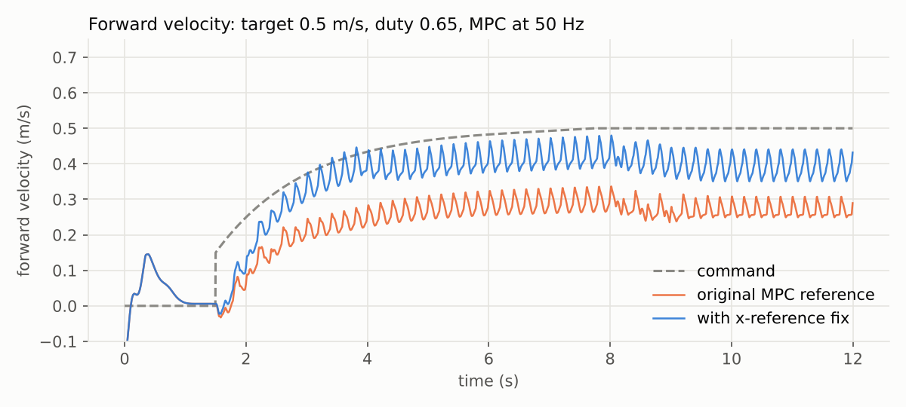
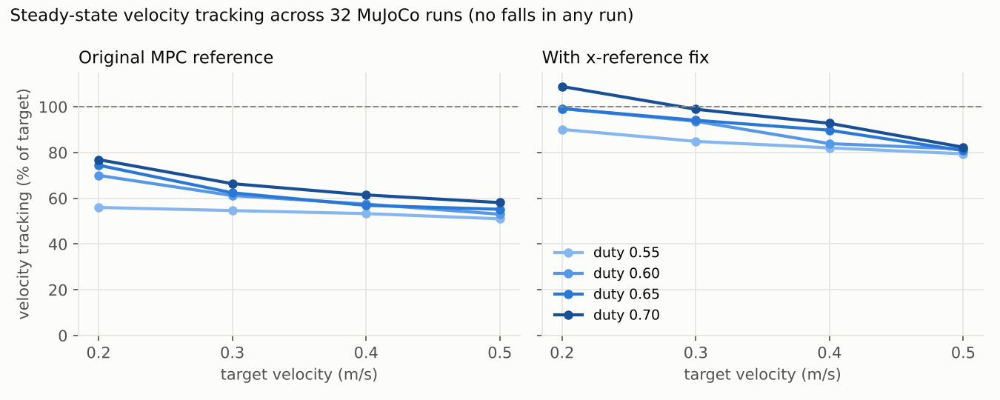

# Go2 Convex MPC: Isaac Gym → MuJoCo Port and Gait Evaluation

Unitree Go2 四足机器人的凸 MPC 行走控制器。原版在 Isaac Gym 中运行（小组项目）；本仓库在此基础上把控制器移植到 MuJoCo，并完成了 32 组步态评测，定位并修正了速度跟踪不足的问题。



## 主要结果（MuJoCo 仿真）

- 移植后控制器代码零改动，32 组参数（4 个目标速度 × 4 个支撑相占比 × 修正前后）全部稳定小跑，无摔倒。
- 定位速度跟踪不足的根因：MPC 参考轨迹中的位置参考恒为 0，而位置权重是速度权重的 10 倍。
- 参考 MIT Cheetah 让位置参考随期望速度推进后，16 组参数全部改善：平均速度跟踪 60.5% → 90.1%，速度 RMSE 0.145 → 0.053 m/s。
- 局限：仅为仿真结果；Python + cvxpy 单次 MPC 求解约 35–45 ms，尚不满足 50 Hz 实时要求。

详细说明见 [README_mujoco.md](README_mujoco.md)，完整评测见 [results/evaluation_report.md](results/evaluation_report.md)。



## 快速开始（不需要 GPU，Windows / Linux / macOS 均可）

```bash
conda create -n go2mj python=3.10 -y
conda activate go2mj
pip install mujoco cvxpy osqp numpy scipy matplotlib imageio imageio-ffmpeg pillow

python scripts/run_mpc_walk_mujoco.py --render                 # 打开窗口观看
python scripts/run_mpc_walk_mujoco.py --mpc-every 4 --fix-xref  # 启用修正，打印指标
python scripts/make_compare_video.py                           # 生成修正前后对比视频
python scripts/eval_gait_sweep.py                              # 完整 32 组评测
```

## 分工说明

本项目起源于小组课程项目，以下按实际分工说明：

| 部分 | 负责人 | 位置 |
| --- | --- | --- |
| MPC 模块：12 维单刚体模型、QP 构造与求解、步态调度 | 全崟杞（借助 AI 编程工具编码） | `mpc_go2/mpc/` |
| Isaac Gym 仿真环境、全身控制（WBC）、摆动腿轨迹、主控脚本 | 小组成员 朱泓羽 | `legged_gym/`、`mpc_go2/wbc/`、`mpc_go2/trajectory/`、`scripts/run_mpc_walk.py` |
| MuJoCo 移植、步态评测、问题定位与修正、视频与图表输出 | 全崟杞（独立完成，借助 AI 编程工具编码） | `mpc_go2/mujoco_env.py`、`scripts/*_mujoco.py`、`scripts/eval_gait_sweep.py`、`scripts/make_*.py`、`results/` |

原 Isaac Gym 版本的说明见 [docs/README_isaacgym_original.md](docs/README_isaacgym_original.md)。

## 第三方资源与许可

- `resources/robots/go2/mjcf/`：Go2 MuJoCo 模型来自 [MuJoCo Menagerie](https://github.com/google-deepmind/mujoco_menagerie)，BSD-3-Clause 许可，原 LICENSE 保留在该目录中。
- `legged_gym/`：基于 legged_gym / unitree_rl_gym 修改，遵循其原始许可。
- `resources/robots/go2/urdf/`、`dae/`：Unitree Go2 的 URDF 与网格文件，版权归原作者所有。
- 控制器设计参考 MIT Cheetah Software 的凸 MPC 框架。
