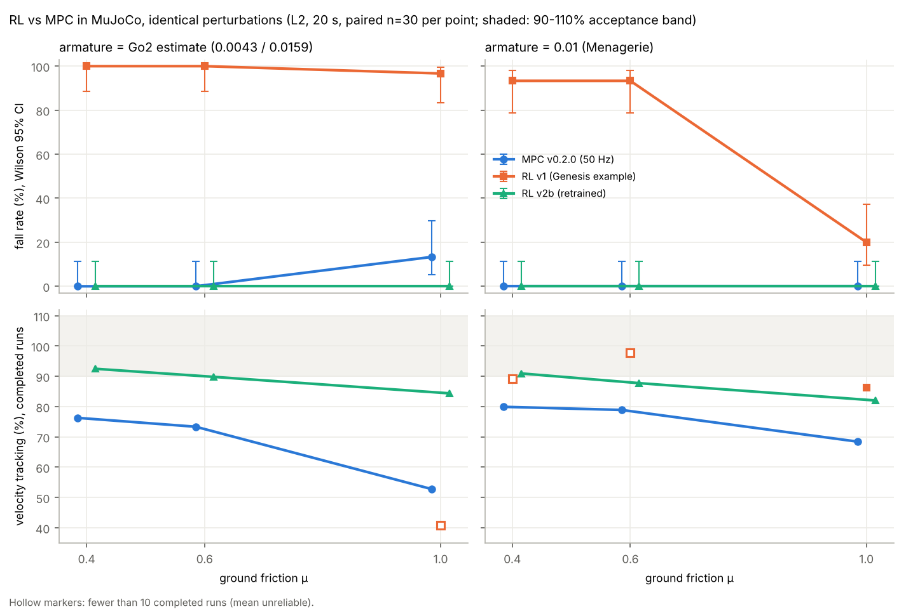

# Go2 Convex MPC: Isaac Gym → MuJoCo Port and Gait Evaluation

[](https://github.com/yinqi2151-tech/go2-mpc-mujoco/actions/workflows/tests.yml)

Unitree Go2 四足机器人的凸 MPC 行走控制器。原版在 Isaac Gym 中运行（小组项目）；本仓库在此基础上把控制器移植到 MuJoCo，并完成了 32 组步态评测，定位并修正了速度跟踪不足的问题。v0.3.0 起加入了 Genesis 训练的 RL 行走策略：把它放进 MuJoCo 做 Sim2Sim 评测，定位侧翻原因，重训后与 MPC 在相同条件下对比。


## 主要结果（MuJoCo 仿真）

- 移植后控制器代码零改动，32 组参数（4 个目标速度 × 4 个支撑相占比 × 修正前后）全部稳定小跑，无摔倒。
- 定位速度跟踪不足的根因：MPC 参考轨迹中的位置参考恒为 0，而位置权重是速度权重的 10 倍。
- 参考 MIT Cheetah 让位置参考随期望速度推进后，16 组参数全部改善：平均速度跟踪 60.5% → 90.1%，速度 RMSE 0.145 → 0.053 m/s。
- 求解耗时（v0.2.0）：改为直接调用 OSQP（稀疏矩阵 + 热启动）后，同一台机器上单次求解中位数从约 30 ms 降到约 9 ms（约 3.5 倍），解与原 cvxpy 实现一致；闭环仿真中 95 分位约 20 ms，刚好处在 50 Hz 预算边缘。
- 局限：仅为仿真结果。

详细说明见 [README_mujoco.md](README_mujoco.md)，完整评测见 [results/evaluation_report.md](results/evaluation_report.md)。


## Sim2Sim：Genesis 训练的 RL 策略（v0.3.0）

- **重复评测代替单次运行**：同一组随机扰动（初始状态噪声 + 推力）施加给所有控制器，摔倒率给 Wilson 95% 置信区间。单次结果在两台机器上不一致，原因是混沌：关节角只差 ±0.005 rad，就有 10% 的运行会摔。
- **差异定位**：把同一策略放回 Genesis，300 次 0 摔；在 MuJoCo 里逐项对齐仿真设置做消融，发现决定因素是关节转子惯量 armature。Genesis 默认 0.1，Menagerie 是 0.01，只改这一项，摔倒率就从 4–96% 降到 0。
- **Go2 真实转子惯量**：按转子惯量 × 减速比² 估计，髋/大腿约 0.0043、小腿约 0.016。官方示例策略在这个值下 1.2 s 就侧翻。
- **重训**：加入 armature 和其他域随机化后（v2b），在 MuJoCo 的 900 次带扰动评测里 0 摔。事先写定的合格线里，速度跟踪一项还差（79–93%，要求 90–110%），原因定位到 Menagerie 足端接触模型。
- **与 MPC 同条件对比**：v2b 在每一格都不比 MPC 差：不摔，跟踪率高约 9–32 个百分点；单次推理约 0.09 ms，MPC 单次求解约 9 ms。

完整过程和数据见 [docs/sim2sim_report.md](docs/sim2sim_report.md)。



## 快速开始（不需要 GPU，Windows / Linux / macOS 均可）

```bash
conda create -n go2mj python=3.10 -y
conda activate go2mj
pip install mujoco cvxpy osqp numpy scipy matplotlib imageio imageio-ffmpeg pillow

python scripts/run_mpc_walk_mujoco.py --render                 # 打开窗口观看
python scripts/run_mpc_walk_mujoco.py --mpc-every 4            # 打印指标（v0.2.0 起默认启用 x_ref 修正）
python scripts/run_mpc_walk_mujoco.py --mpc-every 4 --no-fix-xref  # 关闭修正，复现原始行为
python scripts/make_compare_video.py                           # 生成修正前后对比视频
python scripts/eval_gait_sweep.py                              # 完整 32 组评测

# RL 策略（v0.3.0）
python scripts/run_rl_policy_mujoco.py --policy-dir policies/genesis_go2_v2b --render                 # 观看重训后的策略
python scripts/check_acceptance.py --name v2b --policy-dir policies/genesis_go2_v2b --workers 8     # 验收评测
python scripts/compare_rl_mpc.py                                                                     # RL vs MPC
```

训练在 GPU 服务器上进行，需要 Genesis 和 rsl-rl-lib，见 `training/genesis_go2/run_server.sh`。

## 自动化测试

用 pytest 搭了三层测试，每次 push 由 GitHub Actions 在 Ubuntu 和 Windows 上自动运行：

| 层级 | 文件 | 测什么 |
| --- | --- | --- |
| 单元测试 | `tests/test_qp_constraints.py`、`test_gait.py`、`test_swing_trajectory.py`、`test_frames.py` | QP 解满足力上下限与摩擦锥、问题规模 396 维；步态相位与占空比；摆动轨迹边界条件；四元数顺序 |
| 回归测试 | `tests/test_regression_sim.py` | MuJoCo 闭环跑 12 s：不摔倒、速度跟踪 ≥ 75%、RMSE ≤ 0.15 m/s、机身高度与姿态 |
| 性能测试 | `tests/test_performance.py` | BLAS 线程数必须为 1（防止线程超订复发）；MPC 求解 p95 ≤ 20 ms，且比 v0.1 的 cvxpy 实现快 2 倍以上 |
| 等价性测试 | `tests/test_solver_equivalence.py` | v0.2.0 的快速求解与 v0.1 的 cvxpy 求解结果一致（误差 ≤ 0.05 N） |
| Sim2Sim 工具 | `tests/test_perturbation.py`、`test_sim_align.py` | 同一 seed 扰动可复现、推力冲量符合动量定理、Wilson 区间；不加开关时模型不变、PD 伺服执行器的力等于 PD 公式、Go2 转子惯量估计 |

```bash
pip install -r requirements-test.txt
pytest -m "not sim and not perf"   # 单元测试，约 1 秒
pytest -m perf -s                  # 性能测试，耗时写入 test-reports/perf_summary.json
pytest -m sim                      # 回归测试，约 1 分钟
GO2_DISABLE_XREF_FIX=1 pytest -m sim   # 演示：关掉 x_ref 修正，回归测试会失败
```

测试中发现的已知问题用 `xfail(strict=True)` 标记（修好后测试会提醒去掉标记）。v0.1 记录了两个：步态的摆动相位比接触状态晚一拍（v0.2.0 已修复，标记已去掉）；静止站立时 MPC 计划的首步支撑力约为体重的 80%（仍在记录中）。v0.2.0 另加了求解器等价性测试，并把性能测试收紧到 20 ms 预算。版本变化见 [CHANGELOG.md](CHANGELOG.md)。

## 分工说明

本项目起源于小组课程项目，以下按实际分工说明：

| 部分 | 负责人 | 位置 |
| --- | --- | --- |
| MPC 模块：12 维单刚体模型、QP 构造与求解、步态调度 | 全崟杞（借助 AI 编程工具编码） | `mpc_go2/mpc/` |
| Isaac Gym 仿真环境、全身控制（WBC）、摆动腿轨迹、主控脚本 | 小组成员 朱泓羽 | `legged_gym/`、`mpc_go2/wbc/`、`mpc_go2/trajectory/`、`scripts/run_mpc_walk.py` |
| MuJoCo 移植、步态评测、问题定位与修正、视频与图表输出 | 全崟杞（独立完成，借助 AI 编程工具编码） | `mpc_go2/mujoco_env.py`、`scripts/*_mujoco.py`、`scripts/eval_gait_sweep.py`、`scripts/make_*.py`、`results/` |
| RL Sim2Sim：策略部署、重复评测、差异定位、域随机化重训、验收与对比 | 全崟杞（独立完成，借助 AI 编程工具编码；PPO 训练框架、奖励和网络结构来自 Genesis 官方示例） | `mpc_go2/rl_policy.py`、`perturbation.py`、`sim_align.py`、`training/genesis_go2/`、`scripts/eval_*`、`check_acceptance.py`、`compare_rl_mpc.py`、`docs/sim2sim_report.md` |

原 Isaac Gym 版本的说明见 [docs/README_isaacgym_original.md](docs/README_isaacgym_original.md)。

## 第三方资源与许可

- `resources/robots/go2/mjcf/`：Go2 MuJoCo 模型来自 [MuJoCo Menagerie](https://github.com/google-deepmind/mujoco_menagerie)，BSD-3-Clause 许可，原 LICENSE 保留在该目录中。
- `legged_gym/`：基于 legged_gym / unitree_rl_gym 修改，遵循其原始许可。
- `resources/robots/go2/urdf/`、`dae/`：Unitree Go2 的 URDF 与网格文件，版权归原作者所有。
- 控制器设计参考 MIT Cheetah Software 的凸 MPC 框架。
- `training/genesis_go2/`：基于 [Genesis](https://github.com/Genesis-Embodied-AI/Genesis) 1.4.5 的 `examples/locomotion` 示例（Apache-2.0）修改；RL 训练用 rsl-rl。
