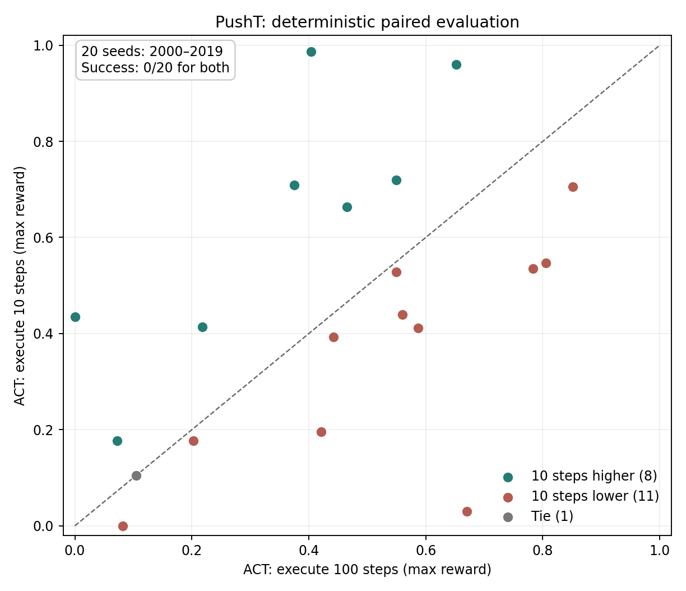

# PushT 具身策略评测报告

## 范围与方法

使用 LeRobot 0.6.1、PushT 仿真任务、单环境同步执行，评测 ACT 与 Diffusion Policy。首批三组运行均为 20 回合，命令记录的起始种子为 1000。ACT 配置对照只改变 `n_action_steps`（100 → 10），其余权重、环境与种子保持一致。另用种子 2000–2019 对 ACT 两种设置做独立复测。

原始 `eval_info.json` 对 ACT 两组提供逐回合奖励与成功标志。已核对 Diffusion 原始 `eval_info.json` 与终端汇总一致，可以做逐种子对照。

## 结果总览

| 策略与设置 | 成功率及 95% Wilson 区间 | 平均回合最高奖励 | 平均累计奖励 | 数据粒度 |
| --- | --- | ---: | ---: | --- |
| ACT；执行 100 步后重规划 | 0/20 (0%); 95% CI 0.0%–16.1% | 0.303 | 19.640 | 逐回合 |
| ACT；执行 10 步后重规划 | 1/20 (5%); 95% CI 0.9%–23.6% | 0.467 | 53.811 | 逐回合 |
| Diffusion Policy；模型默认设置 | 0/20 (0%); 95% CI 0.0%–16.1% | 0.224 | 15.613 | 逐回合 |

`avg_max_reward` 是每回合最高奖励的均值，不是最后一帧的接近程度。成功率区间较宽；20 回合不能支持稳定成功或某策略普遍更优的断言。累计奖励与最高奖励衡量的时间性质也不同。

## 控制变量实验：ACT 重规划频率

- 20 个配对种子中，最高奖励提高 11 回合，下降 8 回合，持平 1 回合。
- 平均配对差（10 步 − 100 步）为 +0.164；中位数为 +0.044。
- 唯一新增成功发生在种子 1007；成功从 0/20 变为 1/20，仍不能证明成功率已稳定提高。
- 种子 1003 的用户视频复核显示：10 步方案一度更接近目标，之后尝试推目标 T 并超时。其最后画面与全程最高奖励反映不同时间点，应分别记录。
- 种子 1007 的用户视频复核显示：10 步方案经过第二次调整成功；100 步方案把可移动 T 推得更远。因果解释仍是待验证假设。

## 失败归因与场景分层

人工复核遵循 `docs/pusht_review_rubric.md`。当前有完整文本观察的只有 ACT 对照实验的种子 1003 与 1007；其余回合不自动标记失败原因。场景层级按初始 T 块与目标位置、角度和推杆位置记录，不能用最终奖励反推初始难度。现有视频观察不足以估计各层级成功率，报告中不伪造分层数字。

## 回归与复现

`scripts/summarize_policy_eval.py` 将 LeRobot 原始结果转为逐回合 CSV、Wilson 区间和摘要；`scripts/compare_policy_evals.py` 校验任务、回合索引和命令记录的种子后生成配对报告。`tests/test_policy_eval_summary.py` 与 `tests/test_policy_portfolio.py` 检查统计、证据粒度和确定性重复运行的一致性。

运行命令、模型版本和证据文件见 `docs/README_policy_eval.md`。LeRobot 汇总文件本身不记录起始种子，配对成立依赖当时命令记录准确、环境版本一致。Diffusion 权重来自第三方模型仓库；不能把此结果归因于 Diffusion Policy 算法本身。

## Diffusion 与 ACT 默认设置的逐种子对照

Diffusion − ACT 的平均配对最高奖励差为 -0.078；6 个种子提高，12 个种子下降。两者权重、架构和推理方式不同，此结果是模型实例对照，不是单因素算法消融。

## 独立种子复测：ACT 重规划频率

下表使用此前未参与参数选择的种子 2000–2019；没有重新挑选动作步数。

| 指标 | 100 步 | 10 步 |
| --- | ---: | ---: |
| 成功回合 | 0/20 | 1/20 |
| 平均回合最高奖励 | 0.418 | 0.445 |
| 配对奖励变化 | — | +0.027 |
| 回合提高 / 下降 | — | 9 / 11 |

两批合计 40 个种子：成功 0/40 → 2/40，平均回合最高奖励 0.361 → 0.456。复测的平均奖励增幅小于首批，且提高回合少于下降回合；不能把首批增幅视为稳定收益。

## 动作扰动测试

在 ACT 每 10 步重规划设置下，沿用种子 2000–2019。对策略输出经过后处理的二维动作，在送入 PushT 环境前加入独立随机数生成器产生的高斯噪声（标准差 5 个动作坐标单位），并裁剪到动作空间。噪声随机种子为 episode seed + 100000；实现见 `scripts/eval_pusht_action_noise.py`。

干净环境成功 1/20，扰动环境成功 1/20；平均回合最高奖励 0.445 → 0.435，平均配对差 -0.010。扰动后成功种子发生替换，详见 `results/act_pusht_noise5_vs_clean_20.md`。

**重复性核查：**同一种子 3000 的原生 LeRobot 评测重复两次，回合最高奖励分别为 0.614、0.392；零噪声包装运行为 0.466。原始文件保存在 `results/act_pusht_clean_seed3000_run*.json` 与 `results/act_pusht_zero_noise_seed3000.json`。固定种子保证 PushT 初始状态抽样，但这些运行未达到逐回合结果完全复现。因此上述扰动差值不能归因于噪声本身，需增加重复运行或排查数值确定性。

## 确定性协议复验：评测修复后的结论

通过 `scripts/eval_pusht_deterministic.py` 固定 PyTorch 确定性算法、cuDNN 行为与 cuBLAS 工作区。种子 3000 的两次原生运行和一次零噪声包装运行最高奖励完全一致；种子 2000–2002 的独立重复运行在逐回合奖励及成功标志上也完全一致。详见 `docs/pusht_determinism.md`。

| ACT 设置（种子 2000–2019） | 成功回合 | 平均回合最高奖励 |
| --- | ---: | ---: |
| 100 步重规划，确定性 | 0/20 | 0.440 |
| 10 步重规划，确定性 | 0/20 | 0.456 |
| 10 步 + 动作噪声 σ=5，确定性 | 1/20 | 0.456 |

10 步相对 100 步的平均配对最高奖励差 +0.017，8 回合提高、11 回合下降；成功率未改善。
动作噪声 σ=5 相对干净 10 步的平均配对差 -0.001，10 回合提高、9 回合下降。当前样本不能证明该扰动有稳定的正面或负面影响。

**结论更新：**首批非确定性消融的 +0.164 平均奖励差没有在独立种子和确定性协议中稳定重现。将缩短重规划周期保留为待进一步验证的候选改动，不能写成已经修好的策略性能问题。

## 后续实验

1. 扩充独立种子集，检查模型排序是否稳定。
2. 对视频补初始场景标签和失败原因，报告覆盖率后再比较场景层级。
3. 在确定性协议下比较多档动作扰动强度，补视觉遮挡实验；目前只有标准差 5 的动作噪声组。
