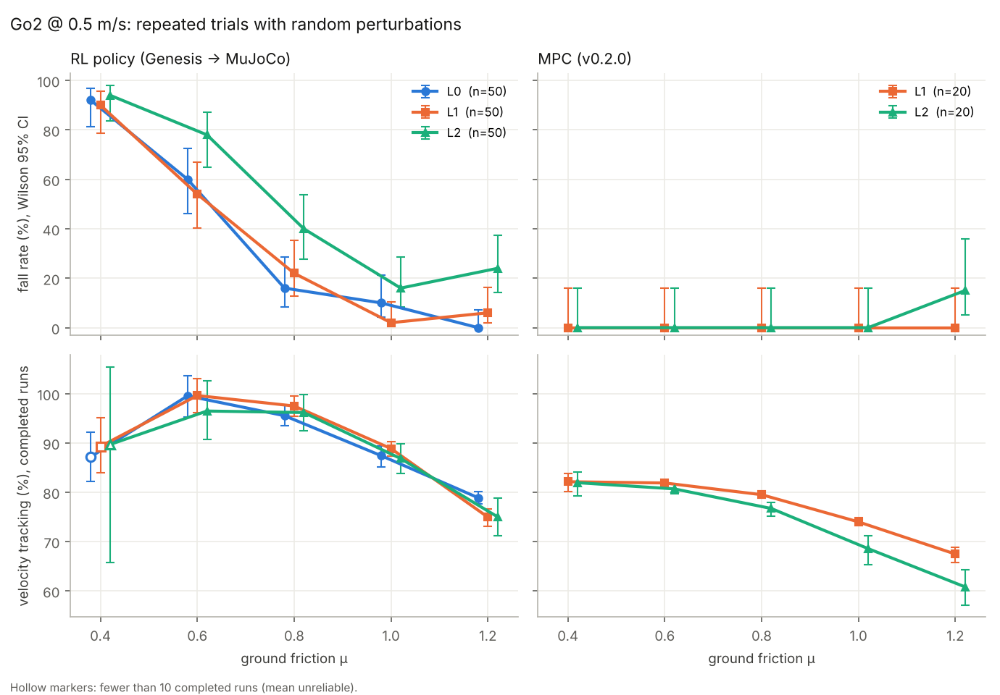
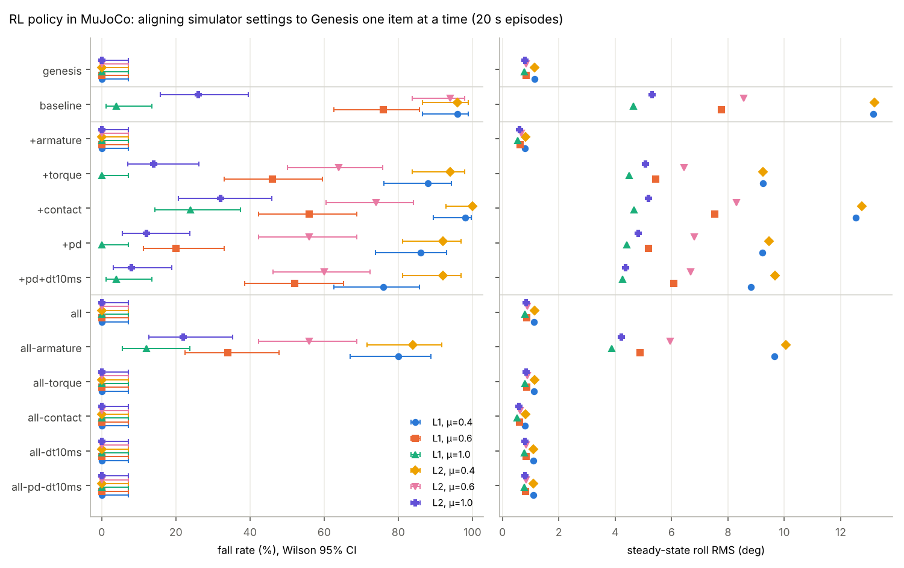
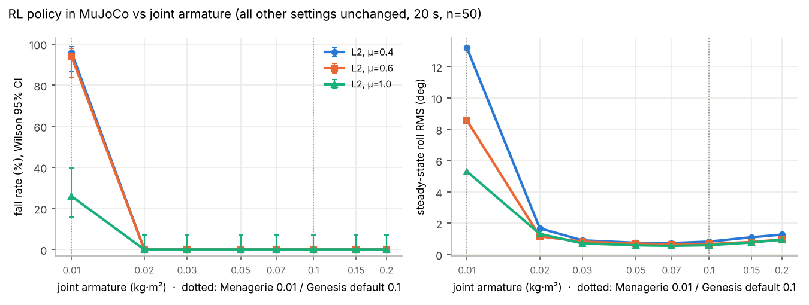

# Sim2Sim 报告：Genesis 训练的 Go2 行走策略在 MuJoCo 中的评测、差异定位与重训

> 一句话：官方示例训练出的策略放进 MuJoCo 会侧翻。重复评测加消融把原因定位到**关节转子惯量（armature）**：Genesis 默认 0.1，MuJoCo Menagerie 是 0.01，按 Go2 的转子和减速比估计约 0.004–0.016。加入 armature 随机化重训后（v2b），在 MuJoCo 的 900 次带扰动评测中没有一次摔倒。但事先定好的合格线里还有一条速度跟踪没过，原因已经定位到足端接触模型。在完全相同的扰动下，v2b 在每一格都不比本仓库的 MPC 差：不摔，而且更快。

全部为仿真结果。RL 的训练框架、奖励函数和网络结构来自 Genesis 官方示例（`examples/locomotion/go2_train.py`，Genesis 1.4.5，rsl-rl PPO）；域随机化、评测和分析是本项目加的。

## 1. 起点：单次结果不可信

最早只跑了单次仿真（0.5 m/s，12 s），结果互相矛盾：
- μ=1.0 时，同一个策略的跟踪率在服务器上是 89.4%，在笔记本上是 83.2%；
- 摩擦扫描 0.4–1.2 里，μ=0.4 和 μ=0.8 摔倒，其余不摔，结果不单调。

单次运行分不清"这个条件真的更难"和"这次刚好运气差"，所以先把评测改成重复实验。

## 2. 评测方法

- **扰动**（`mpc_go2/perturbation.py`，在环境层实现，RL 和 MPC 共用）：
  - L0：关节角 ±0.005 rad，只用来检验结果对极小差异是否敏感；
  - L1：关节角 ±0.05 rad、横滚/俯仰 ±3°、偏航 ±5°、高度 ±2 cm、线速度 ±0.1 m/s、角速度 ±0.2 rad/s；
  - L2：在 L1 基础上，6–7 s 和 9–10 s 各推一次，每次 0.1 s、方向随机，使机身速度改变约 0.5 m/s。
- **配对设计**：同一个 seed 在所有条件、所有控制器下的扰动完全相同。
- **摔倒判据**：机身高度 < 0.15 m，或横滚/俯仰超过 0.8 rad。
- **统计**：摔倒率给 Wilson 95% 置信区间；跟踪率（稳态平均速度 ÷ 指令速度）只在没摔的运行上统计，给 bootstrap 95% 置信区间。
- 不加扰动时，所有改动都和改之前的结果逐位一致（RL 89.44%，MPC 83.89%），由 `tests/test_perturbation.py` 和 `tests/test_sim_align.py` 锁住。

## 3. 重复评测：v1 策略（官方示例）在 MuJoCo 中

`scripts/eval_sim2sim_repeat.py`，每个条件 50 次，12 s：

| μ | L0 微扰 | L1 初始扰动 | L2 +推力 |
|---|---|---|---|
| 0.4 | 92% [81, 97] | 90% [79, 96] | 94% [84, 98] |
| 0.6 | 60% [46, 72] | 54% [40, 67] | 78% [65, 87] |
| 0.8 | 16% [8, 29] | 22% [13, 35] | 40% [28, 54] |
| 1.0 | 10% [4, 21] | 2% [0, 10] | 16% [8, 29] |
| 1.2 | 0% [0, 7] | 6% [2, 16] | 24% [14, 37] |

- 摔倒率随摩擦基本单调下降，之前"不单调"是抽样造成的假象。
- 关节角只差 ±0.005 rad，μ=1.0 就有 10% 会摔。也就是说，两台机器单次结果不同是混沌放大了浮点差异，不是程序错误。
- 302 次摔倒全部是横滚侧翻；稳态段 68–96% 的运行横滚超过训练时的终止线（10°）。



## 4. 差异定位

### 4.1 Genesis 参照组

把同一个策略放回 Genesis（训练用的仿真器），施加完全相同的扰动（`scripts/eval_genesis_reference.py`）：μ 0.4 / 0.6 / 1.0 × L1 / L2 × 50 次 × 20 s，**300 次 0 摔**，横滚 RMS 0.8–1.1°，从不超过 10°。所以 MuJoCo 里的高摔倒率来自两个仿真器的差异，而不是策略本身。

### 4.2 逐项对照

| 项目 | Genesis 训练时 | MuJoCo（Menagerie） |
|---|---|---|
| 质量 / 惯量 / 质心 | 一致（URDF 把小腿拆成 4 段，合起来相同） | 一致 |
| **转子惯量 armature** | URDF 没写，用 Genesis 默认值 **0.1** | **0.01** |
| 小腿力矩上限 | 35.55 N·m（其实是 Go1 的值） | 45.43 N·m |
| PD | 求解器内部计算，每 10 ms 子步一次，kd 隐式 | 1 kHz 显式 |
| 积分器 / 步长 | approximate_implicitfast，10 ms | Euler，1 ms |
| 接触 | 金字塔摩擦锥、无扭转/滚动摩擦、默认 solref/solimp、关闭自碰撞 | 足端 condim=6（扭转 0.02、滚动 0.01）、软 solimp、椭圆锥 + impratio=100 |

每一项都做成开关（`mpc_go2/sim_align.py`）。

### 4.3 消融

12 个配置 × 6 个条件 × 50 次，20 s（`scripts/eval_sim2sim_gap.py`）：

- **只改 armature 0.01 → 0.1**：6 个条件全部 0/50 摔（原来是 4–96%），横滚和 Genesis 一致；
- 其他各项单独改：只能部分降低摔倒率，比如 μ=0.6 加推力时从 94% 降到 56–74%；
- 其他全部对齐、只留 armature 是 0.01：仍然摔 12–84%；
- 全部对齐后再任意去掉另外一项：仍然 0 摔。



**armature 扫描**（其余保持 MuJoCo 原设置）：0.01 时摔 26–96%，0.02 时已经 0 摔，0.02–0.2 全部稳定。阈值非常陡。



## 5. Go2 的真实转子惯量（估计）

关节上的等效转子惯量 = 电机转子惯量 × 减速比²（`mpc_go2/sim_align.py` 里的 `GO2_ARMATURE_EST`）：
- 转子惯量 1.118e-4 kg·m²：取自 Unitree 官方 `go2_description` URDF 里的转子连杆。这个数和 Go1 的 URDF 完全相同，可能是沿用而不是实测。
- 减速比：髋/大腿 ≈ 6.22（拆解得到的单级行星齿数，1 + 47/9）；小腿再乘 ≈ 1.92（力矩上限 45.43/23.7、速度上限 30.1/15.7 的比例都是 1.92）。
- 结果：髋/大腿 ≈ **0.0043**，小腿 ≈ **0.0159**。没算行星轮的惯量，所以偏小，不确定度估计在 ±50% 量级。

Genesis 用的 0.1 比这个估计大 6–23 倍。**v1 策略在估计值下 1.2 s 就侧翻**，这意味着它直接上真机大概率也不行。

## 6. 合格线（重训前写定）

`scripts/check_acceptance.py`，任何新策略都用同一套条件和规则，只输出 PASS / FAIL：

- 条件：MuJoCo 原设置；armature ∈ {Go2 估计值, 0.01, 0.1}；μ ∈ {0.4, 0.6, 1.0}；扰动 L2；每格 100 次 × 20 s。
- 每一格都要满足：
  - C1：摔倒率的 Wilson 95% 置信区间上界 < 10%（100 次最多摔 4 次）；
  - C2：没摔运行的平均跟踪率在 90%–110% 之间。
- 另外用 Genesis 参照组按同样规则检查训练仿真器本身。

## 7. 重训与验收

训练代码在 `training/genesis_go2/`，在服务器单张 GPU 上用 `run_server.sh` 一键运行：

- **v2a**：只加 armature 随机化（12 个关节各自在 [0.004, 0.1] 里对数均匀采样），300 轮，365 s。
- **v2b**：在 v2a 基础上再加：
  - 摩擦 [0.3, 1.25]、机身附加质量 [-1, 2] kg、电机强度 ×[0.8, 1.2]、随机一步延迟；
  - 每 4 s 推一次（Δv ≤ 1 m/s）；
  - 小腿力矩上限改为 45.43；
  - 机身倾斜惩罚、横滚/俯仰角速度惩罚；
  - 多速度指令；终止角放宽到 30°。

  训练 1000 轮，用时 2276 s。

| 策略 | MuJoCo 摔倒（9 格 × 100 次） | MuJoCo 跟踪率 | Genesis 摔倒 / 跟踪率 | 结论 |
|---|---|---|---|---|
| v1 官方示例 | Go2 估计值 99–100%、0.01 时 30–97%、0.1 时 0% | 84–97% | 0 / 107–119% | FAIL |
| v2a | 共 7 次（Go2 估计值、μ=1.0 摔 5 次） | 69–90% | 0 / 89–94% | FAIL |
| v2b | **900 次 0 摔** | 78.6–92.6% | 0 / 95–100% | FAIL（只差 C2） |

v2b 在 Genesis 里换成 Go2 估计 armature 也不摔，跟踪率 101–104%。

## 8. 剩下的问题：MuJoCo 里速度偏低

`scripts/diag_v2_contact.py`：Go2 估计 armature，L2，每格 30 次：

| 策略（μ 0.4 / 0.6 / 1.0 的跟踪率） | MuJoCo 原设置 | 只换成 Genesis 接触参数 | 只换 PD 隐式 + 10 ms 步长 |
|---|---|---|---|
| v2b | 92.5 / 89.8 / 84.4% | **105.6 / 105.3 / 103.8%** | 90.7 / 88.1 / 83.0% |
| v2a | 89.8 / 81.8 / 66.3% | **110.6 / 107.0 / 100.3%** | 88.6 / 82.0 / 67.3% |

速度偏低完全来自 Menagerie 的足端接触模型，和 PD、步长无关。按事先写定的规则 v2b 仍然判 FAIL，标准不改。哪种接触模型更接近真机的橡胶脚，只有真机数据能回答。

## 9. RL 与 MPC 同条件对比

`scripts/compare_rl_mpc.py`：同一个 MuJoCo 环境（Menagerie 接触），同一组扰动（L2，前 30 个 seed 与 RL 验收完全相同），20 s。MPC 用 v0.2.0，每 4 个控制周期解一次（50 Hz，与 RL 策略同频，也是 v0.2.0 实测求解耗时下能实时运行的频率）。

| 控制器 | armature | 摔倒（μ 0.4 / 0.6 / 1.0，每格 30 次） | 跟踪率（μ 0.4 / 0.6 / 1.0） | 横滚 RMS |
|---|---|---|---|---|
| MPC v0.2.0 | Go2 估计值 | 0 / 0 / **4** | 76.3 / 73.4 / 52.8% | 1.6–2.1° |
| MPC v0.2.0 | 0.01 | 0 / 0 / 0 | 79.9 / 78.9 / 68.4% | 1.3–1.5° |
| RL v1 | Go2 估计值 | 30 / 30 / 29 | — | — |
| RL v1 | 0.01 | 28 / 28 / 6 | 86–98%（没摔的少数几次） | 3.4–4.5° |
| RL v2b | Go2 估计值 | 0 / 0 / 0 | 92.5 / 89.8 / 84.4% | 0.28–0.38° |
| RL v2b | 0.01 | 0 / 0 / 0 | 90.9 / 87.7 / 82.0% | 0.22–0.34° |


- **v2b 在每一格都不比 MPC 差**：不摔，跟踪率高约 9–32 个百分点，横滚只有 MPC 的五分之一左右。
- MPC 对转子惯量也有一定敏感性：换成 Go2 估计值后变慢，μ=1.0 时 30 次摔 4 次，都是推力后 0.7–1.2 s 内俯仰超限。
- 两者都是摩擦越大越慢，说明 Menagerie 足端接触模型对两种控制器都有影响（见第 8 节）。
- 计算量：RL 策略一次前向约 0.09 ms（numpy，单核）；MPC 单次求解中位数约 9 ms、95 分位约 20 ms（v0.2.0 实测）。
- 公平性说明：MPC 在 200 Hz（每个周期都解）时速度更好一些（例如 μ=0.4 无扰动时 83.9%），但那样单次求解超出实时预算；MPC 的稳态窗口从速度指令爬升到 97% 之后开始，RL 从 3 s 开始。v1 那一行跟踪率只来自极少数没摔的运行，不可靠。

## 10. 局限与下一步

- 全部是仿真结果，没有真机验证；Go2 的转子惯量是估计值。
- 下一步：
  1. 在 Menagerie 接触参数里逐项排查，找出是哪一项让机器人变慢；
  2. 训一版 v2c，在 Genesis 里打开扭转/滚动摩擦、随机化接触软硬，用同一套合格线再测；
  3. 有条件的话，用真机测一次速度和转子惯量。

## 11. 复现

```bash
# MuJoCo 侧（笔记本即可，不需要 GPU）
python scripts/eval_sim2sim_repeat.py --controllers rl --n 50          # 第 3 节
python scripts/eval_sim2sim_gap.py && python scripts/eval_sim2sim_gap.py --armature-sweep   # 第 4 节
python scripts/check_acceptance.py --name v2b --policy-dir policies/genesis_go2_v2b       # 第 6–7 节
python scripts/diag_v2_contact.py                                       # 第 8 节
python scripts/compare_rl_mpc.py                                        # RL vs MPC
# Genesis 侧（训练服务器，单卡）
GPU=0 bash training/genesis_go2/run_server.sh
```
